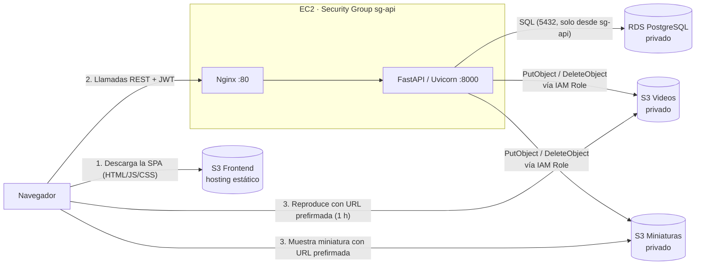
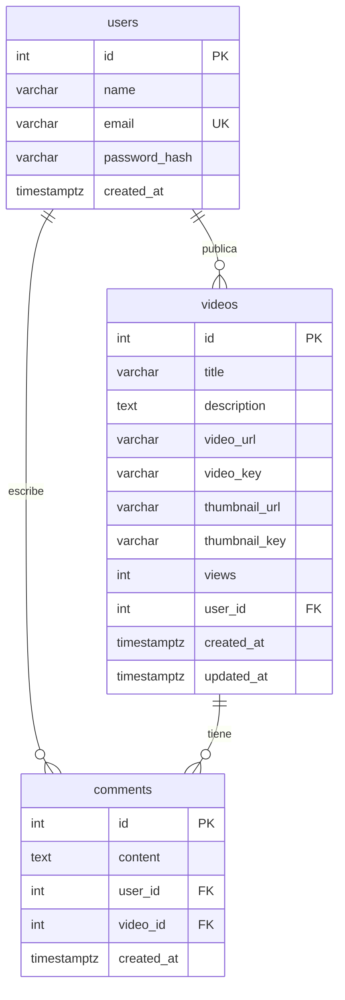

# StreamHub — Plataforma de videos con React, FastAPI y AWS

SPA tipo plataforma de videos: registro/login, catálogo dinámico, reproductor con comentarios y recomendados, y perfil para publicar, editar y eliminar videos.

| Capa | Tecnología | Servicio AWS |
|---|---|---|
| Frontend (SPA) | React 19 + Vite + TypeScript + React Router | **S3** (hosting estático) |
| API | FastAPI + SQLAlchemy 2 + Alembic + Uvicorn (detrás de Nginx) | **EC2** |
| Base de datos | PostgreSQL 16 | **RDS** |
| Videos (MP4) | — | **S3** privado |
| Miniaturas (JPG/PNG) | — | **S3** privado |

> 🔗 **URL de la SPA:** `http://streamhub-frontend-XXXX.s3-website-us-east-1.amazonaws.com`
> 🔗 **API / Swagger:** `http://<IP-ELASTICA-EC2>/docs`
> *(reemplaza con tus URLs reales al desplegar)*

---

## Arquitectura



**Flujo de publicación:** la SPA envía `multipart/form-data` → la API valida extensión, *magic bytes* y tamaño → sube los archivos a S3 → guarda los metadatos en RDS. Si algo falla en la BD, borra lo subido a S3 (no quedan archivos huérfanos).

**Flujo de reproducción:** la API nunca expone los buckets; entrega **URLs prefirmadas** temporales. El navegador descarga el video directamente desde S3 (con soporte de `Range`, así se puede adelantar el video), sin pasar por EC2.

---

## Buenas prácticas aplicadas

**Seguridad**
- **Cero credenciales en el código.** Configuración por variables de entorno (`pydantic-settings`); en EC2 viven en `/etc/streamhub/api.env` (permisos `640`). El acceso a S3 usa el **IAM Role** de la instancia (boto3 lo detecta solo).
- Contraseñas con **Argon2id** (`pwdlib`, recomendado por OWASP). Autenticación con **JWT** firmado y con expiración.
- Login resistente a *user enumeration* (mismo mensaje y mismo tiempo de respuesta si el correo no existe).
- Buckets de medios **privados**, cifrados (SSE-S3) y servidos con URLs prefirmadas. Solo el bucket del frontend es público.
- **RDS sin acceso público**: su Security Group solo acepta el puerto 5432 desde el Security Group de EC2.
- Permisos **mínimos** (least privilege): la política IAM solo permite `Put/Get/DeleteObject` en los 2 buckets de medios.
- Validación doble de archivos: en el cliente (UX) y en el servidor por **contenido real** (*magic bytes*), no solo por extensión.
- CORS restringido al origen del frontend. Solo el dueño puede editar/eliminar sus videos (`403` si no).
- `/users/{id}` es público y **no** expone el correo; `/users/me` sí (solo al propio usuario).

**Backend**
- Arquitectura por capas: `routes` → `schemas` (Pydantic) → `models` (ORM) → `services` (S3).
- **Migraciones versionadas con Alembic** (nada de `create_all` en producción).
- Conteo de vistas con `UPDATE ... SET views = views + 1` atómico (sin condiciones de carrera).
- Consultas sin N+1 (`selectinload`), índices en `email`, `user_id`, `video_id`, `created_at`; paginación con `limit/offset`.
- `GET` nunca modifica datos: las vistas se registran con `POST /videos/{id}/view`.
- `pool_pre_ping` para conexiones RDS; endpoint `/health` que verifica la BD.
- **26 pruebas automatizadas** (pytest + moto, sin tocar AWS) y linting con Ruff.
- Cliente S3 con **endpoint regional** (`https://<bucket>.s3.<región>.amazonaws.com`): evita errores de firma/redirección en las URLs prefirmadas.
- **Diagnóstico de conexión** `python -m app.diagnostics`: verifica IAM Role, RDS (tablas) y S3 (subir, leer con URL prefirmada y borrar) en cada bucket.

**Frontend**
- **HTML semántico**: un solo `<main>`, páginas como `<section>`, tarjetas como `<article>` con CSS Grid, `<header>/<footer>/<nav>/<aside>`, `<hgroup>`, `<fieldset>`, `<progress>`, `<dialog>`, `<ol>/<menu>`, `<time>`. Prácticamente sin `<div>` (solo los 2 que exige `<dl>`).
- TypeScript estricto, cliente HTTP centralizado, manejo uniforme de errores (incluye 422 de FastAPI).
- *Code-splitting* por página, *skeletons* de carga, cancelación de peticiones con `AbortController`.
- Barra de progreso real de subida, vista previa de miniatura, modales accesibles (`<dialog>`), diseño responsive.
- Cierre de sesión automático al expirar el token o al recibir `401`.
- Build optimizado: assets con hash + caché larga; `index.html` sin caché.

**DevOps**
- Uvicorn gestionado por **systemd** (reinicio automático) detrás de **Nginx** (límite de 110 MB, timeouts, cabeceras de seguridad).
- Script de instalación idempotente para EC2 y script de despliegue del frontend.
- CI en GitHub Actions: lint + tests del backend, lint + build del frontend.

---

## Estructura del repositorio

```text
.
├── backend/
│   ├── app/
│   │   ├── main.py              # App FastAPI, CORS, /health
│   │   ├── core/                # config (env vars) y seguridad (Argon2, JWT)
│   │   ├── db/session.py        # engine y sesiones SQLAlchemy
│   │   ├── models/              # User, Video, Comment
│   │   ├── schemas/             # Esquemas Pydantic de entrada/salida
│   │   ├── services/storage.py  # S3: validación, subida, URLs prefirmadas
│   │   └── api/routes/          # users, auth, videos, comments
│   ├── alembic/                 # migraciones de la BD
│   ├── tests/                   # pytest + moto
│   ├── deploy/                  # systemd, nginx, setup_ec2.sh
│   ├── requirements.txt
│   └── .env.example
├── frontend/
│   ├── src/
│   │   ├── api/                 # cliente HTTP + tipos
│   │   ├── auth/                # contexto de sesión
│   │   ├── components/          # Header, VideoCard, formularios, UI
│   │   └── pages/               # Auth, Home, Player, Profile (las 4 páginas)
│   ├── scripts/deploy-s3.sh
│   └── .env.example
├── infra/aws/                   # políticas IAM/S3 y script de buckets
├── docs/
│   ├── DEPLOY_AWS.md            # guía paso a paso de despliegue
│   ├── EVIDENCIAS.md            # checklist de capturas para la entrega
│   └── GUION_VIDEO.md           # guion del video explicativo
├── docker-compose.yml           # Postgres + S3 simulado para desarrollo
└── .github/workflows/ci.yml
```

---

## Endpoints de la API

| Método | Ruta | Auth | Descripción |
|---|---|:---:|---|
| `POST` | `/users` | | Registro (nombre, correo, contraseña) |
| `POST` | `/login` | | Login OAuth2 (form: `username`=correo, `password`) → JWT |
| `GET` | `/users/me` | ✅ | Mi perfil (incluye correo y nº de videos) |
| `GET` | `/users/{id}` | | Perfil público + nº de videos |
| `POST` | `/videos` | ✅ | Publicar (multipart: `title`, `description`, `video`, `thumbnail`) |
| `GET` | `/videos` | | Catálogo: `q`, `user_id`, `sort=recent\|popular`, `limit`, `offset` |
| `GET` | `/videos/{id}` | | Detalle del video |
| `PUT` | `/videos/{id}` | ✅ dueño | Actualizar título, descripción y/o miniatura |
| `DELETE` | `/videos/{id}` | ✅ dueño | Eliminar video, miniatura, archivos S3 y comentarios |
| `GET` | `/videos/{id}/recommended` | | Recomendados (mismo autor primero, luego más vistos) |
| `POST` | `/videos/{id}/view` | | Suma una vista |
| `POST` | `/videos/{id}/comments` | ✅ | Comentar |
| `GET` | `/videos/{id}/comments` | | Listar comentarios (recientes primero) |
| `GET` | `/health` | | Estado de la API y de la BD |

Documentación interactiva: **`/docs`** (Swagger) y `/redoc`. En `/docs`, pulsa **Authorize** e ingresa tu correo en *username*.

## Modelo de datos (RDS)



`video_url`/`thumbnail_url` guardan la URL canónica del objeto en S3; `*_key` guarda la clave para generar URLs prefirmadas y borrar el archivo. RDS **solo** guarda datos estructurados.

---

## Ejecutar en local

Requisitos: Python 3.11+, Node 20+, Docker.

```bash
# 1) Base de datos + S3 simulado
docker compose up -d

# 2) API
cd backend
python -m venv .venv && source .venv/bin/activate      # Windows: .venv\Scripts\activate
pip install -r requirements-dev.txt
cp .env.example .env
#   En .env ajusta: DB_HOST=localhost, DB_PORT=5432, DB_USER=streamhub, DB_PASSWORD=devpass,
#   DB_SSLMODE=disable, S3_ENDPOINT_URL=http://localhost:5000,
#   S3_VIDEOS_BUCKET=streamhub-videos-local, S3_THUMBNAILS_BUCKET=streamhub-thumbnails-local,
#   CORS_ORIGINS=http://localhost:5173,http://localhost:4173
#   AWS_ACCESS_KEY_ID=local, AWS_SECRET_ACCESS_KEY=local   ← SOLO para el emulador local; en EC2 NO se ponen
AWS_ACCESS_KEY_ID=local AWS_SECRET_ACCESS_KEY=local python scripts/create_local_buckets.py
alembic upgrade head
python -m app.diagnostics                               # verifica BD + S3
uvicorn app.main:app --reload                           # http://localhost:8000/docs

# 3) Frontend (otra terminal)
cd frontend
cp .env.example .env                                    # VITE_API_URL=http://localhost:8000
npm install
npm run dev                                             # http://localhost:5173
```

Pruebas y calidad:

```bash
cd backend && pytest && ruff check .
cd frontend && npm run lint && npm run build
```

## Despliegue en AWS

Ver **[docs/DEPLOY_AWS.md](docs/DEPLOY_AWS.md)** (paso a paso con consola y CLI).

## Mejoras futuras

- HTTPS con dominio propio: CloudFront delante del bucket del frontend y un ALB + ACM (o Nginx + Let's Encrypt) para la API.
- Secretos en AWS Secrets Manager / SSM Parameter Store en vez de archivo `.env`.
- Subida directa del navegador a S3 con *presigned POST* (descarga trabajo de EC2 para archivos grandes).
- Transcodificación HLS con MediaConvert y miniaturas automáticas.
- Refresh tokens en cookie `HttpOnly`, *rate limiting* en `/login`.
